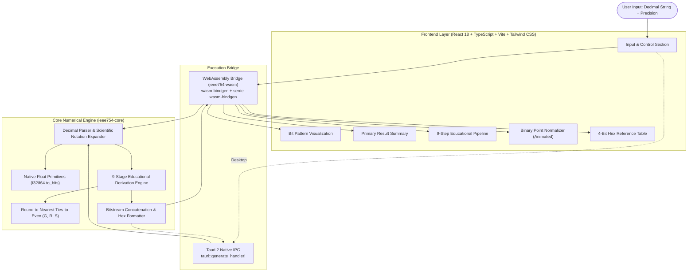
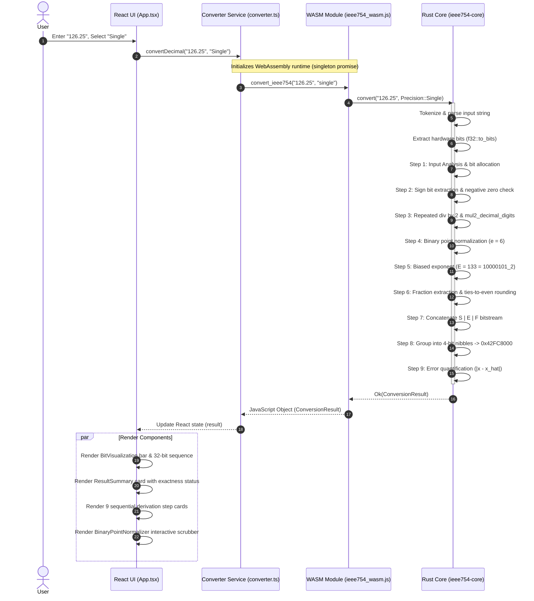

# Floatio — System Architecture

> **Definitive Technical Architecture Document**  
> *Author: JAYCEE 曾令强*  
> *Target Platforms: Modern Browsers (WASM), Windows Desktop (Tauri 2)*

---

## 1. Executive Summary

**Floatio** is an educational software system engineered to bridge the gap between abstract computer arithmetic theory and practical binary encoding. Rather than functioning as a black-box calculator, it implements a transparent mathematical derivation pipeline that decomposes any real decimal number into IEEE 754 single-precision (binary32) or double-precision (binary64) representations.

The system uses a **Single Source of Mathematical Truth** architecture: a core Rust engine (`ieee754-core`) handles all parsing, division, multiplication, normalization, rounding, and assembly. This same core compiles natively for desktop execution via Tauri 2 and compiles to WebAssembly for browser deployment via Vercel.

---

## 2. High-Level Architecture Diagram



---

## 3. Monorepo Structure & Crate Topology

The repository is structured as a Cargo workspace with decoupled web and desktop applications:

```
├── crates/
│   ├── ieee754-core/          # Pure Rust mathematical and educational conversion engine
│   │   ├── Cargo.toml
│   │   └── src/
│   │       ├── lib.rs         # Public interface (convert)
│   │       ├── types.rs       # Domain data structures & serde serialization
│   │       ├── parser.rs      # String tokenizer & arbitrary decimal processor
│   │       ├── steps.rs       # 9 derivation stage builders & mul2_decimal_digits
│   │       └── tests.rs       # 12 automated unit & integration test cases
│   └── ieee754-wasm/          # WebAssembly compilation layer
│       ├── Cargo.toml
│       └── src/
│           └── lib.rs         # wasm-bindgen export (convert_ieee754)
├── apps/
│   ├── web/                   # Responsive web application (Vite + React)
│   │   ├── package.json
│   │   ├── vite.config.ts
│   │   ├── tailwind.config.js
│   │   ├── src/
│   │   │   ├── wasm/          # Compiled WebAssembly binary & JS bindings
│   │   │   ├── components/    # UI components (Header, Steps, Normalizer, MathView)
│   │   │   ├── services/      # WASM initialization & converter service
│   │   │   ├── types.ts       # TypeScript mirrors of Rust domain models
│   │   │   └── utils/         # 4-bit nibble formatting & string helpers
│   │   └── dist/              # Production static distribution for Vercel
│   └── desktop/               # Desktop native wrapper (Tauri 2)
│       ├── package.json
│       ├── src-tauri/
│       │   ├── Cargo.toml     # References ieee754-core directly
│       │   ├── tauri.conf.json# Window, bundle, icon, and NSIS configuration
│       │   ├── icons/         # 16x16 up to 256x256 ICO and PNG assets
│       │   └── src/
│       │       ├── lib.rs     # Tauri IPC command registration
│       │       └── main.rs    # Application entry point
├── target/release/bundle/nsis/# Windows x64 NSIS Installer (.exe)
├── docs/                      # Technical manuals & specifications
├── vercel.json                # Vercel deployment configuration
└── Cargo.toml                 # Cargo workspace configuration
```

---

## 4. Key Architectural Decisions (ADRs)

### ADR-1: Centralized Mathematical Source of Truth
- **Decision:** All mathematical logic resides solely in `crates/ieee754-core`. The frontend never computes exponents, shifts bits, or determines hexadecimal nibbles independently.
- **Rationale:** Prevents logic drift between desktop and web builds. Validates that educational explanations match hardware IEEE 754 representations down to the exact bit.

### ADR-2: WebAssembly in Browser vs. Remote Backend
- **Decision:** Compile `ieee754-core` to WebAssembly using `wasm-bindgen` and bundle it with Vite as a local asset.
- **Rationale:** Zero network latency, offline capability, zero cloud operational costs, and infinite scalability when deployed to static CDNs such as Vercel.

### ADR-3: Arbitrary-Precision Decimal Fraction Multiplication
- **Decision:** Implement `mul2_decimal_digits(&[u8]) -> (u8, Vec<u8>)` for base-10 digit-by-digit arithmetic during Step 3 repeated multiplication.
- **Rationale:** Standard primitive integers (`u64`, `u128`) overflow when parsing decimal fractions with more than 19 digits (such as $\pi = 3.14159265358979323846\dots$). The digit-by-digit approach can process arbitrary digit lengths without overflow.

### ADR-4: 64-bit Integer & BigInt Serialization Strategy
- **Decision:** Sized all structural bit counts, step numbers, and table indices as `u32` in Rust, while reserving `u64` strictly for raw binary values (`bits_raw`, `fraction_raw`) configured via `serialize_large_number_types_as_bigints(true)`.
- **Rationale:** JavaScript's `Number.MAX_SAFE_INTEGER` ($2^{53} - 1$) cannot hold a 64-bit IEEE 754 double bitstream. Declaring metadata counts as `u32` allows `serde_wasm_bindgen` to serialize them as standard JavaScript numbers, enabling normal arithmetic in React layout calculations without BigInt type conflicts.

### ADR-5: Strict DM Sans Typographic Hierarchy with KaTeX Isolation
- **Decision:** Enforce DM Sans globally across all UI components, tables, buttons, and bitstreams, while isolating KaTeX math fonts through scoped CSS rules (`*:not(.katex *):not(.katex)`).
- **Rationale:** Satisfies visual branding requirements while preserving KaTeX's specialized glyph tables for integral signs, radicals, and brackets.

---

## 5. Data Flow & Execution Lifecycle



---

## 6. Performance & Security Considerations

- **Client-Side Execution:** The application executes entirely in the user's browser or native WebView. No user input or calculations are sent to an external server.
- **Constant Memory Footprint:** The educational step generator caps repeating fractional multiplication tables at 80 rows, ensuring DOM rendering remains fluid even for irrational or repeating decimal fractions.
- **Content Security Policy (CSP):** The application requires no external APIs or dynamic code evaluation (`eval`), making it safe for high-security educational and enterprise environments.
